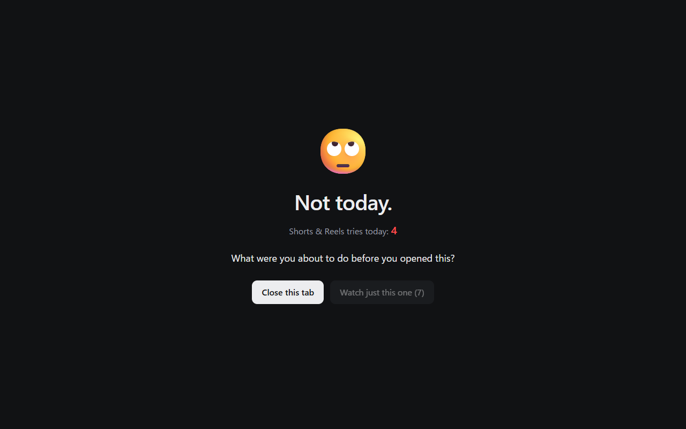

<h1 align="center">I'm so tired of scrolling</h1>

A browser extension that catches you right before the endless scroll on <b>YouTube Shorts</b> and
<b>Instagram Reels</b> starts. Not a prison, just a pause. Free, open source, no tracking.

<a href="https://wmcmo.github.io/so-tired-of-scrolling/">Website</a> ·
<a href="https://github.com/wmCmo/so-tired-of-scrolling/releases/latest">Download</a> ·
<a href="PRIVACY.md">Privacy</a>

## What it does

- **Opening a Short or a Reel** sends you to a calm stop page instead: "Not today.", how many times you've tried today,
  and one question, *what were you about to do?*
- **Still want it?** After 10 seconds, *Watch just this one* opens that single video in the normal player
  (YouTube) or as a single post (Instagram). No swipe, no next, no feed after it.
- **The ways in are hidden:** Shorts shelves, the Shorts sidebar tab and Shorts in search results on YouTube; the
  Reels and Explore buttons on Instagram.
- **Everything else is left alone:** normal YouTube videos, your Instagram feed, posts, profiles and DMs.

| Site | Stopped | Hidden |
|---|---|---|
| YouTube | `/shorts/…` | Shorts shelves, sidebar and channel tabs, Shorts in results |
| Instagram | `/reels/`, `/reel/…`, `/explore/…` | Reels and Explore buttons |

## Install

From the store: Edge Add-ons and Chrome Web Store listings are coming soon.

From GitHub:

1. Download `so-tired-of-scrolling-<version>.zip` from [Releases](https://github.com/wmCmo/so-tired-of-scrolling/releases/latest) and unzip it.
2. Open `edge://extensions` or `chrome://extensions` and turn on **Developer mode**.
3. Click **Load unpacked** and pick the unzipped folder.

## Privacy

It stores two values in your browser (today's date and today's try count) and makes no network requests of its own.
See [PRIVACY.md](PRIVACY.md).

## Development

No build step: the repository root is the extension. Load it unpacked from a clone to try changes.

| File | Role |
|---|---|
| `content.js`, `hide.css` | YouTube: catch `/shorts/` (load, in-app navigation, clicks), hide the entrances |
| `ig.js`, `ig-hide.css` | Instagram: catch Reels and Explore, hide their buttons |
| `blocked.html`, `blocked.js` | The stop page and the daily counter |
| `tools/package.py` | Builds `dist/so-tired-of-scrolling-<version>.zip` for the stores |
| `docs/` | The website (GitHub Pages) |

YouTube and Instagram change their pages often. If Shorts or Reels show up again, the selectors in `hide.css` and
`ig-hide.css` are the first place to look. Issues and pull requests are welcome.

## Credits

The face is the "Face with rolling eyes" emoji from [Fluent Emoji](https://github.com/microsoft/fluentui-emoji) by
Microsoft, MIT License (see [THIRD_PARTY_NOTICES.md](THIRD_PARTY_NOTICES.md)).

## License

[MIT](LICENSE)
